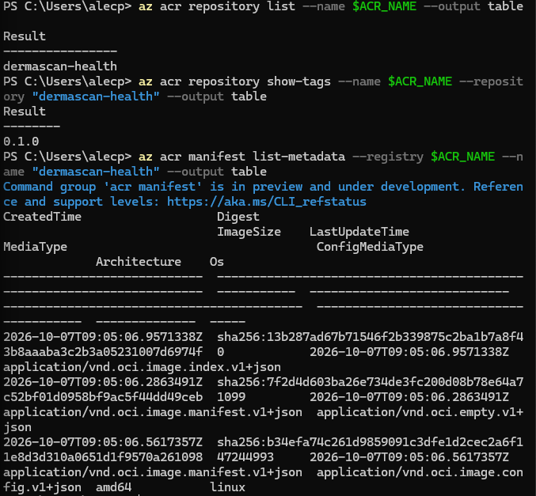

# Tableau de décisions

|Décision                                             | Contrainte                                       | Votre valeur                 |
|-----------------------------------------------------|--------------------------------------------------|------------------------------|
|Suffixe personnel 4 à 6 caractères                   | minuscules et chiffres                           | ap24                         |
|Région Azure une seule                               | la même partout                                  | westeurope                   |
|Nom du groupe de ressources                          | préfixé rg-dermascan-registre                    | rg-dermascan-registre-ap24   |
|Nom du registre ACR minuscules et chiffres           | unique sur Azure                                 | acrdermascanap24             |
|Nom de l'image ce que l'image contient               | pas votre nom                                    | dermascan-health             |
|Tag de version initial                               | versionnage sémantique                           | 0.1.0                        |
|Image de base Python variante légère                 | version explicitement fixée, jamais latest       | python:3.11-slim             |
|Répertoire de travail dans l'image chemin absolu     | le même dans le Dockerfile et le CMD             | /app                         |
|Port d'écoute de l'application cohérent entre EXPOSE | la variable PORT et vos -p                       | 8000                         |
|uid de l'utilisateur d'exécution non nul             |  au-delà de 10000                                | 10001                        |

## Question 0.1
    Azure expose publiquement chaque registre sous la forme d'un sous-domaine DNS global unique.

---
---

# Partie 1 - Fondamentaux du cloud
## 1.1 - Les trois modèles de service

| Modèle | Géré par le fournisseur | À ma charge | Exemple Azure |
|---|---|---|---|
| IaaS | Matériel, réseau physique, virtualisation | OS, mises à jour, runtime, application, données | Azure Virtual Machines |
| PaaS | Matériel, réseau, virtualisation, OS et correctifs, runtime | Code, configuration, données | Azure App Service |
| SaaS | Toute la pile, application comprise | Données, utilisateurs et droits d'accès | Microsoft 365 |

## 1.2 - Où s'arrête votre responsabilité

| Couche | Dernier modèle où c'est à moi |
|---|---|
| Correctifs de sécurité de l'OS | IaaS |
| Version du runtime Python | IaaS |
| Code de l'application | PaaS |
| Dimensionnement du nombre d'instances | PaaS |
| Données métier | SaaS |

### _Question 1.1_
    données métier restent sous votre responsabilité quel que soit le modèle cloud.

## 1.3 -  Les cinq caractéristiques NIST

| Caractéristique | Traduction opérationnelle |
|---|---|
| Libre-service à la demande | Je crée une ressource sans ouvrir de ticket ni attendre l'accord d'un humain. |
| Accès réseau large | J'administre et j'utilise le service depuis n'importe quel poste connecté, via portail, CLI ou API. |
| Mise en commun des ressources | Mon registre tourne sur une infrastructure partagée avec d'autres clients ; je choisis une région, pas une machine. |
| Élasticité rapide | J'augmente ou je réduis la capacité en quelques minutes, sans acheter de matériel. |
| Service mesuré | Chaque ressource est comptée et facturée tant qu'elle existe, et visible dans Cost Management. |

### _Question 1.2_
    le service mesuré. Toute ressource allouée est comptabilisée en continu par Azure, de sorte qu'une ressource oubliée continue d'être facturée sur votre crédit, même inutilisée.

## 1.4 - Exploration du portail Azure

#### 1. Il y a 9 champs.
#### 2. ID : 0f8250e1-72cb-4b9d-bfd8-9caeb8108c8c. Etat : actif.
#### 3. Il n'existe aucun groupe de ressource pour l'intant.
#### 4. 88 €.
#### 5. Pas de quotas car pas de ressource.
#### 6. Sert à organiser, catégoriser et suivre les coûts les ressources.

| Service Azure | Modèle |
|---|---|
| Azure Virtual Machines | IaaS |
| Azure App Service | PaaS |
| Azure Container Registry | PaaS |
| Azure Machine Learning (espace managé) | PaaS |
| Microsoft 365 | SaaS |

### _Question 1.3_
    - Non, elle ne peut appartenir qu'à un seul groupe de ressources
    - La suppression d'un groupe de ressources entraîne la suppression de l'ensemble des ressources qu'il contient
    - Non. La région du groupe stocke uniquement ses métadonnées.

---
---

# Partie 2 - Mise en place de l'environnement

## 2.1 - Authentification Azure CLI
    identifiant : 0f8250e1-72cb-4b9d-bfd8-9caeb8108c8c
    tenant : 38e72bba-3c22-4382-9323-ac1612931297

## 2.2 - Choix de la région et groupe de ressources
### _Question 2.1_
    - Il y a 109 régions possible.
    - La conformité réglementaire (RGPD) et la latence.
### Mesure
    Succeeded
### _Question 2.2_
    Non ça n'a pas consommer de crédit

## 2.3 - Vérification de Docker

| Élément | Commande | Valeur |
|---|---|---|
| Version du client Docker | docker version | 29.8.2 |
| Version du démon (server) | docker version | 29.8.2 |
| Architecture | docker info | x86_64 (amd64) |
| Images déjà présentes | docker info | 0 |
| Mémoire allouée au démon | docker info | 31.18 GiB |

---
---

# Partie 3 - Conteneuriser l'application

## 3.1 -  L'application fournie

### _Question 3.1_
    Écouter sur 0.0.0.0 est indispensable car cela permet à l'application d'accepter les requêtes réseau venant de l'extérieur du conteneur, alors que 127.0.0.1 restreindrait l'écoute à l'interface de boucle locale interne au conteneur, le rendant totalement injoignable de l'hôte.

## 3.2 - Écriture du Dockerfile

### _Question 3.2_
    Oui, le conteneur fonctionne parfaitement même si EXPOSE est oublié.

### _Question 3.3_
    Si le fichier .dockerignore est absent, Docker inclut tout le dossier.

## 3.3 - Construction et première mesure

| Mesure | valeur |
|---|---|
| Durée du premier build (cache vide) | 3,8700108 |
| Taille de l'image | 195MB |
| Nombre de couches listées par docker history | 4 |
| Couche la plus lourde, et son instruction | 81.9kB |
| Taille de l'image de base seule ( docker images python ) | 125 Mo |

### _Question 3.4_
    L'image de base représente 64,10 % de la taille finale

## 3.4 - Exécution locale et test

| Mesure | Votre valeur |
| --- | --- |
| Code HTTP retourné | 200 |
| Champ hostname du JSON | 04a58b8aef04 |
| Champ version du JSON | 0.1.0 |
| Champ status du JSON | ok |

### _Question 3.5_
    C'est l'ID du conteneur qui est créé automatiquement à la création
    la valeur change à chanque lancement du conteneur

### _Question 3.6_
    oui la version change, l'image contient le code source et les dépendances alors que l'environnement est injecté à l'execution

## 3.5 - Ordre des instructions et cache de build

| Scénario | Durée du build | Nombre d'étapes CACHED | `pip install` rejoué ? |
| --- | --- | --- | --- |
| A — Bon ordre      | 2,776684                     | 6                       | non |
| B — Mauvais ordre  | 6,3508274                    | 4                       | oui |
| Écart A / B        | 3,57s plus rapide pour A | +2 étapes en cache  | 56% temps gagné |

### _Question 3.7_
    Docker réutilise une couche si l'instruction du Dockerfile et les fichiers copiés sont stricts à l'identique du build précédent.
    Dès qu'une modification est détectée, le cache de cette couche est invalidé.
    Cette invalidation force la réexécution de cette étape et de toutes les étapes suivantes, annulant le cache jusqu'à la fin du build.

### _Question 3.8_
    actuel : 20 * 3,57s = 71,4s de plus
    avec les bibliothèques python : 20 * 45s = 900s -> 15min (on prend 45s en moyenne)

## 3.6 - Contrôle de l'utilisateur non-root

| Contrôle | Résultat attendu | Votre observation |
| --- | --- | --- |
| id dans le conteneur | uid non nul | uid=10001(appuser) gid=10001(appuser) groups=10001(appuser) |
| .Config.User de l'image | Non vide | appuser |
| Écriture dans /etc | Refusée | touch: cannot touch '/etc/test': Permission denied |

### _Question 3.9_
    En root, l'attaquant prend le contrôle du conteneur et peut exploiter des failles pour s'échapper vers le système hôte.
    En appuser, il reste bloqué dans l'application avec des droits limités, sans accès aux fichiers système.

---
---

# Partie 4 - Azure Container Registry

## 4.1

| Élément | Votre valeur |
| --- | --- |
| loginServer du registre | acrdermascanap.azurecr.io |
| SKU retenu | Basic |
| État d'approvisionnement | Succeeded |
| Coût mensuel annoncé | 5,01€ / mois (0,167€/jour) |

### _Question 4.1_
    basic : 10GO
    standard : 100GO
    premium : 500GO
    On devrait passer en premium si il nous faut une connexion privé pour raisons de conformité médical.

## 4.2 - Authentification sur le registre

### _Question 4.2_
    il y a l'adresse du registre avec un token
    le fichier contient les ID actif et donc n'importe qui pourra lire/push/supprimer les images.

### _Question 4.3_
    le compte admin est un compte générique, partager entre plusieurs personnes, on ne sait donc pas qui a fait quoi
    il y a un probleme avec le mot de passe qui est donc partager entre plusieurs personnes donc possible fuite et si une personne part on dois le changer pour garantir la sécurité.

## 4.3 - Étiquetage et publication

| Mesure | Votre valeur |
| --- | --- |
| Durée du push | 3s |
| Nombre de couches poussées | 11 |
| IMAGE ID local et IMAGE ID taggé : identiques ? | oui |
| Digest ( sha256:... ) retourné en fin de push | sha256:13b287ad67b71546f2b339875c2ba1b7a8f43b8aaaba3c2b3a05231007d6974f |

### _Question 4.4_
    Non, le 2e push est quasiment instatané
    ça affiche "Layer already exists"
    ça veut dire qu'on ne repush pas un layer si il existe deja

## 4.4 - Vérification dans le registre

| Mesure | Votre valeur |
| ---- | ---- |
| Durée du docker run avec téléchargement | 5 secondes |
| Le JSON de santé est-il identique à celui de la partie 3.4 ?| Oui |
| Le hostname a-t-il changé ? | Oui |

---
---

# Partie 5 - Gouvernance : fiche d'identité du conteneur

## 5.1 - Collecte des informations

### _Question 5.1_
    il y a 5 paquets supplémentaire
    ce sont les dépendances de flask
    car le fichier requirements n'a pas les dépendances directement déclarées, alors que pip freez fait la liste des paquets réellement embarquer dans le conteneur

### _Question 5.2_
    Flask : `aucun`
    CPython : 2001-2023 Python Software Foundation.
    Paquets système de Linux : GPL-3+ (debian)

---
---

# Partie 6 - nettoyage

| Contrôle de fin de séance | Votre observation |
| :--- | :--- |
| Espace disque libéré par docker system prune | ~450 MB (ou la valeur exacte affichée lors du prune) |
| Nombre de ressources laissées actives dans $RG | 1 (acrdermascanap24) |
| SKU du registre, et son coût journalier estimé | Basic (~0,167 € / jour) |
| Date portée par l'étiquette a_detruire | 2026-11-30 |
| Nombre de groupes de ressources vous appartenant au total | 1 (rg-dermascan-registre-ap24) |
| Crédit restant, relevé dans Cost Management | 88 € |

### _Question 6.1_
    Conservé : Registre ACR `acrdermascanap24` (groupe `rg-dermascan-registre-ap24`)
    Sert de dépôt central pour l'image `dermascan-health`, indispensable pour les TP suivant
    À détruire au plus tard le 30 novembre 2026 (fin du module)

### _Question 6.2_
    le --no-wait redonne la mains au terminal (donc il s'execute e parallèle des autres) si il ne marche pas en arriere plan alors il n'y aura pas de message et les ressources restent activent et continue de conssomer
    on fait un az group exists --name $RG pour s'assurer manuellement de la suppression